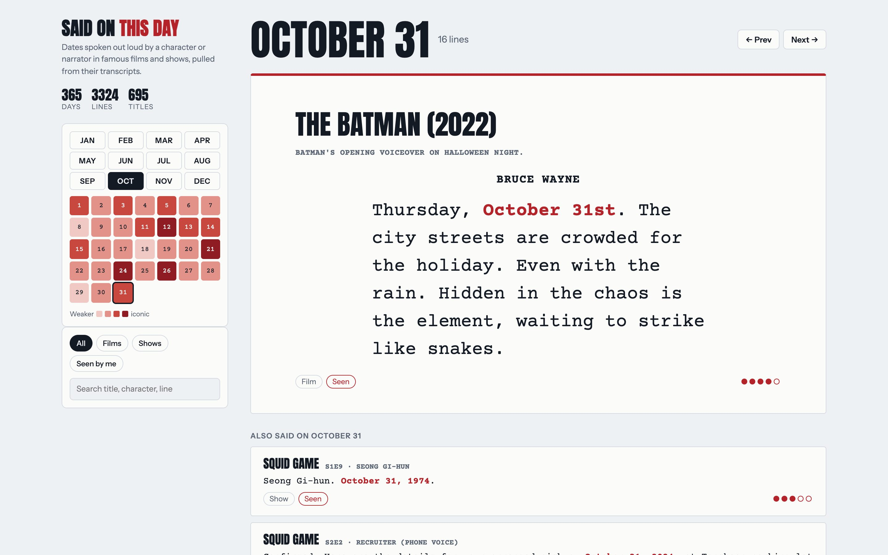
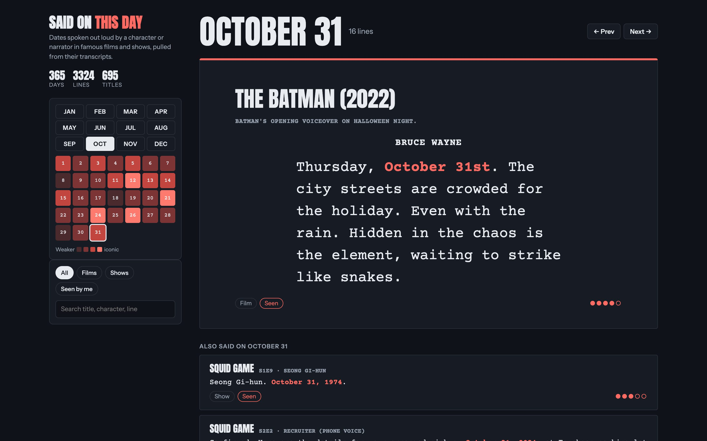
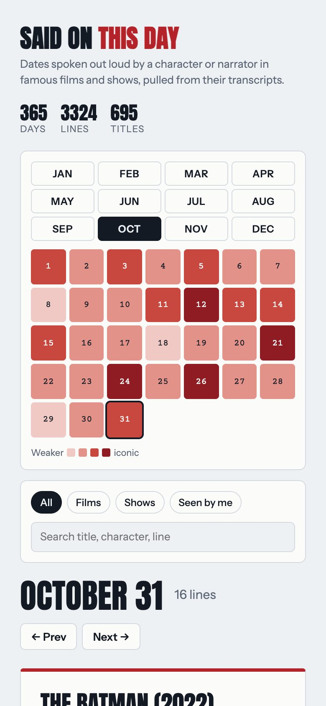
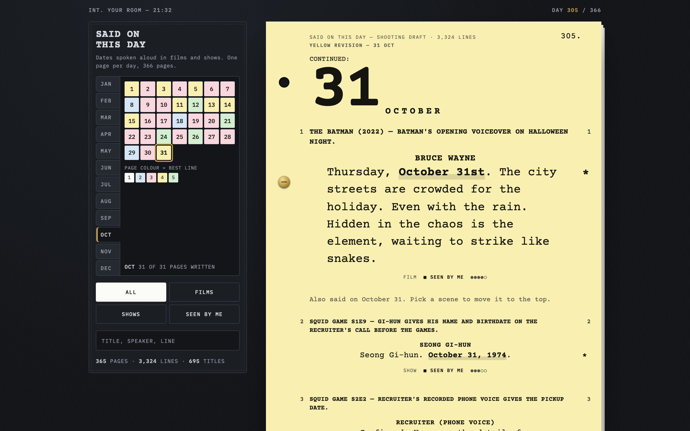
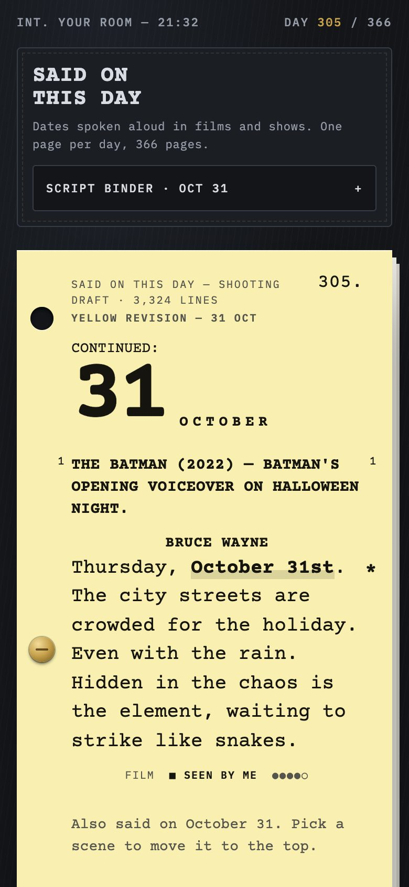
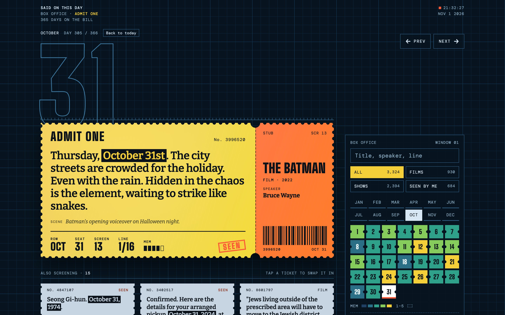
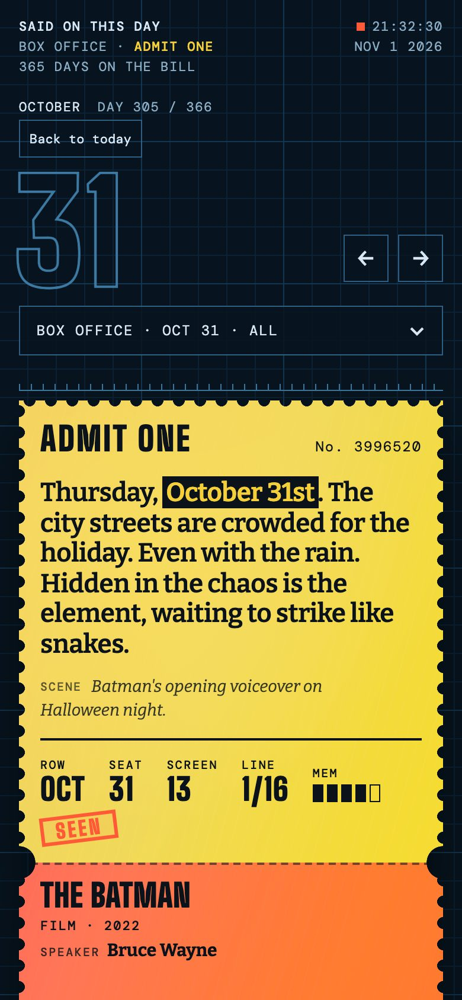
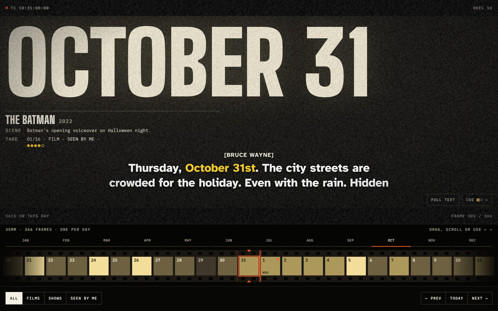
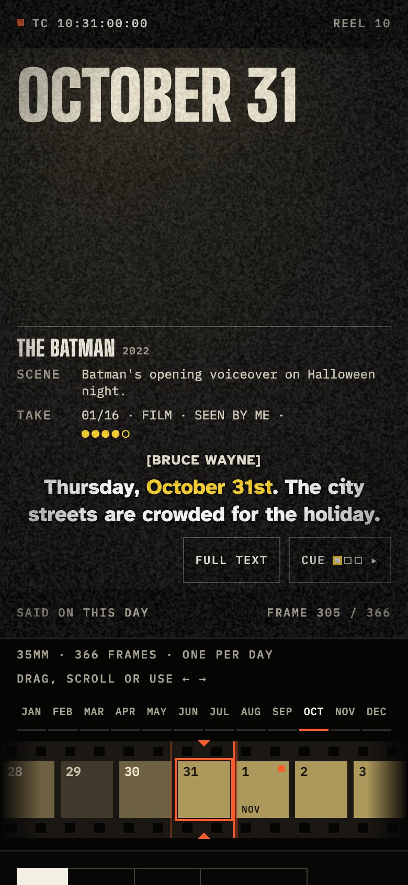

# Said On This Day

A 366-day calendar of dates that characters **say out loud** in famous films and TV shows, like Rorschach's *"October 12th, 1985"* in Watchmen or Doc Brown's *"November 5, 1955"* in Back to the Future.

- **3,324 lines across 365 days.** December 29 is the one date nobody says in anything searched.
- Each line has the quote, who says it, the scene, and a 1–5 "how memorable" score.
- Open `calendar/said-on-this-day.html` in a browser. Pick a day in the sidebar; the best line takes the stage.

## Screenshots

All on October 31. Taken by `tests/ui_test.py --shots`.

| | Desktop | Dark | Phone |
|---|---|---|---|
| **Main calendar** |  |  |  |
| **A. Shooting Script** |  |  |  |
| **B. Admit One** |  |  |  |
| **C. Film Leader** |  |  |  |

The three concepts live in `calendar/concepts/`. Each has one fixed palette by design (dark backdrop), so its light and dark shots match; only the main calendar switches with the system theme.

## Rules for what counts

From [`data/DECISIONS.md`](data/DECISIONS.md):

- The date must be **spoken or narrated** (dialogue, voiceover, a journal read aloud). On-screen title cards don't count.
- Holidays count only when the date itself is said ("December 24th", not "Christmas Eve").
- Real-history dates count when a character says them.
- Hollywood first; famous Bollywood and international films are in too.

## How it was built

1. **Titles.** About 2,300 films from ~30 "best of" lists (AFI, Sight & Sound, IMDb, Rotten Tomatoes genre lists, US box-office top 10s 1975–2025, *1001 Movies You Must See Before You Die*) merged in `lists/`, ranked by how many lists each appears on. Plus ~270 TV shows.
2. **Transcripts.** `scripts/fetch.py` downloads subtitle transcripts from springfieldspringfield.co.uk (about 19,000 films and episodes).
3. **Find dates.** `scripts/extract.py` regex-scans every transcript for dates ("October 12th", "the 4th of July", "12 October 1985", spelled-out ordinals), fixing subtitle OCR glitches like "1 2th".
4. **Check.** `scripts/prep_batches.py` dedupes and batches the hits; LLM agents then decide whether each is a real spoken date, who says it, clean the quote, and score it.
5. **Speakers.** Top lines per day were re-checked against screenplays and fan transcripts that name the speaker (`data/speakers.json`).
6. **Build.** `scripts/build_calendar.py` writes `data/calendar.json` and the HTML page; `scripts/build_concepts.py` rebuilds the three concepts.

```sh
python3 scripts/fetch.py data/titles_movies.csv   # transcripts -> transcripts/
python3 scripts/extract.py                         # -> data/hits.jsonl
python3 scripts/prep_batches.py                    # -> data/batches/
python3 scripts/build_calendar.py                  # -> calendar/said-on-this-day.html
```

## Tests

`tests/ui_test.py` drives the installed Chrome with Playwright and checks every page at desktop (1440), tablet (820), phone (390) and small phone (320) widths, in light, dark and reduced-motion modes. Latest results: [`tests/report.md`](tests/report.md).

- Loads with no JS errors; no sideways scrolling at any width.
- Deep links (`#d1031`), hash changes, Feb 29 and the empty Dec 29.
- Arrow keys, all 12 month buttons, every day button, every filter, search (lands on a matching day), "show more".
- Film Leader: mouse drag and touch swipe on the film strip.
- Drawers open on phones; tap targets of at least 24px; axe-core accessibility scan.

```sh
pip install playwright
python3 tests/ui_test.py           # tests -> tests/report.md
python3 tests/ui_test.py --shots   # also refresh docs/screenshots/
python3 scripts/build_concepts.py  # rebuild the concept pages after editing a template
```

## What's in the repo

| Path | What |
|---|---|
| `calendar/` | The calendar page and its template |
| `calendar/concepts/` | Three redesign concepts (Script, Ticket, Film Leader) |
| `tests/` | Browser tests and the latest report |
| `docs/screenshots/` | Screenshots of every page |
| `data/verified.jsonl` | Every checked date mention (kept and dropped, with reason) |
| `data/calendar.json` | The kept lines the page uses |
| `lists/` | The source "best of" lists |
| `scripts/` | The pipeline |
| `picker/` | A show-picker page used to choose which shows to search |

Transcripts are not included: they're copyrighted subtitle text. `fetch.py` re-downloads them. Quotes in the calendar are short excerpts for reference.
